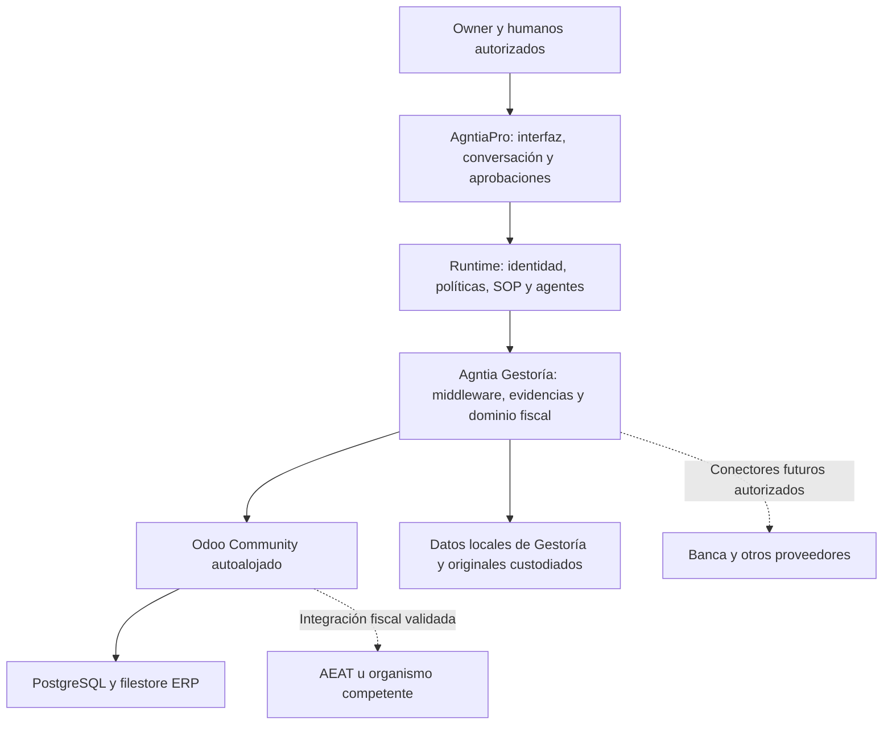

# Visión y plan de producto: Agntia Gestoría como middleware de Odoo Community

Versión: 1.0 · Fecha: 2026-11-10 · Propietario: AgntiaPro.

Estado: especificación de producto y hoja de ruta. Este documento describe lo que queremos conseguir, lo que podemos aprovechar y el trabajo pendiente. No acredita funciones instaladas, cumplimiento universal, nuevas pruebas ejecutadas ni autorización para emitir facturas, presentar impuestos o desplegar en producción.

Base revisada: implementación Odoo de la PR [#4](https://github.com/uniscrolliabrain-cloud/agntia-gestoria/pull/4), código `84504053d71c966db58d8de0fdf44b9817ebef82`, documentación posterior `ccf021fba56498d4ff75be74058e46faa94da09f`. Al redactar, esa PR está abierta y no fusionada; `main` sigue en `1fd25d932a26acab0d865aa4aa3d7ed83876282e`. La evidencia de las siguientes versiones debe consultarse en GitHub, sin heredar estos resultados a cambios posteriores.

## 1. Decisión de producto que gobierna el proyecto

**Agntia Gestoría será el middleware inteligente de nuestro Odoo Community, gestionado y autoalojado por nosotros.** El cliente opera desde AgntiaPro con humanos y agentes. Odoo funciona como backend empresarial y puede disponer de acceso administrativo interno.

Aprovecharemos los módulos existentes de Odoo Community y extensiones seleccionadas. No necesitamos desarrollar otra base de contactos, otro motor de inventario o un ERP contable desde cero. El trabajo propio conecta esas capacidades con identidad, permisos, propuestas, aprobaciones, evidencias, seguimiento y experiencia de usuario.

Nuestro objetivo es cubrir progresivamente el ciclo empresarial que un cliente espera de soluciones como Holded: ventas, compras, facturación, gastos, bancos, contabilidad, impuestos, equipo y operaciones. Holded sirve como referencia de recorridos completos y facilidad de uso; no es una promesa de paridad ya alcanzada ni una dependencia técnica.

Una función disponible en el código de Odoo no está automáticamente instalada en nuestra instancia, validada para España o disponible a través de AgntiaPro. Para cada capacidad distinguiremos esos estados.

## 2. Experiencia que queremos para el cliente

El owner abre AgntiaPro y puede pedir, por ejemplo:

- «Prepara un presupuesto para este cliente y enséñamelo antes de enviarlo».
- «Convierte el presupuesto aceptado en una factura y pídeme autorización para emitirla».
- «Recoge las facturas recibidas esta semana y dime cuáles tienen problemas».
- «¿Qué clientes me deben dinero y cuánto vence este mes?».
- «Prepara el cierre del trimestre y explícame lo que falta».
- «Muéstrame el margen de cada proyecto y los gastos que han aumentado».
- «Prepara las nóminas para revisión», cuando exista y esté validada la integración laboral.

El sistema traduce la petición a un proceso identificable. Devuelve documentos, cifras, fuentes, propuestas y estados. Las acciones con efectos externos pasan por su política y, cuando corresponda, aprobación humana. Una respuesta del chat no sustituye la ejecución ni un justificante.

Un humano también debe poder consultar, corregir y revisar los datos desde pantallas claras. El chat ayuda a ejecutar y entender; los formularios, tablas y aprobaciones siguen disponibles. La experiencia debe funcionar en escritorio y móvil. No se presupone que estas nuevas pantallas empresariales estén ya implementadas.

## 3. Arquitectura y responsabilidades

| Pieza | Responsabilidad | Autoridad principal |
|---|---|---|
| AgntiaPro | Experiencia, sesión, organización, conversación y supervisión | Identidad y permisos organizacionales |
| Runtime de agentes | SOP, asignación, planificación y seguimiento del trabajo real | Ejecuciones y política organizacional |
| Gestoría | Operaciones cerradas, clasificación fiscal, revisión, cálculos propios acotados, evidencias y adaptadores | Expedientes y hechos fiscales declarados/revisados |
| Odoo Community | Contactos, productos, ventas, compras, facturas y demás entidades ERP instaladas | Datos operativos y contables del ERP |
| Banca/proveedor autorizado | Movimientos y confirmación efectiva de operaciones financieras | Realidad bancaria |
| Administración tributaria | Recepción, validación y justificantes de trámites | Resultado administrativo oficial |

Odoo y Gestoría pueden conservar copias/proyecciones, pero una entidad no debe tener dos escritores que se sobrescriban sin reglas. Se documentará la autoridad por campo y los conflictos exigirán resolución cuando sea necesaria.

La sincronización entre SQLite y PostgreSQL no es una transacción única. Las operaciones usan estados persistentes, claves idempotentes, outbox y conciliación. Un timeout no demuestra que una escritura haya fallado.

## 4. Qué existe y qué sigue pendiente

| Estado | Significado |
|---|---|
| Implementado con prueba local/CI | Hay código ejecutado contra fixtures o interfaces simuladas, con evidencia del alcance de la prueba |
| Disponible en upstream | Existe un módulo o implementación pública; falta comprobar instalación, licencia, dependencias y comportamiento en nuestro despliegue |
| Pendiente de integración | La capacidad aún no está expuesta como operación de negocio en nuestro middleware/AgntiaPro |
| Pendiente de validación real | Hay implementación, pero falta probar el proveedor, permisos, persistencia o recorrido real |
| Operativo para piloto | Recorrido validado de extremo a extremo en entorno aislado y con límites documentados |
| Operativo en producción | Además cumple los gates operativos, fiscales y de aceptación definidos para ese despliegue |

En la PR #4 existen: conexiones y scopes, transporte JSON-2, discovery, binding explícito empresa/DB, contactos y lectura de facturas, staging, importación no verificada, procedencia, conflictos, jobs, cursores, adjuntos cifrados, propuestas y aprobaciones, escritura de contactos y facturas borrador mediante bridge, API, SDK TypeScript/Hono, herramientas agénticas y laboratorio sintético.

La base anterior aporta empresas, expedientes, documentos, registros económicos, borradores, revisiones, dashboard, reportes y motores 303/130 de 2026 en un ámbito muy delimitado.

Evidencia registrada: 57 tests Python y 4 Node aprobados en CI, más comprobaciones de dashboard escritorio/móvil, creación de registro y descarga de informe. Esa evidencia **no prueba Odoo real, VERI*FACTU, banca, presentación fiscal o nóminas**. Ver [resultados CI](docs/odoo-adapter/c20/ci-results.json) y [aceptación pendiente](docs/odoo-adapter/pilot-acceptance.md).

## 5. Mapa de capacidades objetivo

| Área | Qué queremos que consiga el cliente | Qué aprovecharemos | Trabajo de middleware/producto pendiente |
|---|---|---|---|
| Identidad empresarial | Varias empresas y usuarios aislados | Empresas Odoo y scopes Gestoría | Onboarding AgntiaPro y validación real multiempresa |
| Contactos | Clientes/proveedores coherentes y sin duplicados indebidos | res.partner y adaptador existente | Experiencia completa de alta, edición y conflictos |
| CRM | Seguir oportunidades y próximas acciones | crm | Operaciones nominadas, permisos y pantallas |
| Ventas | Presupuesto, aceptación y pedido | sale_management/sale | Propuestas, aprobaciones, envío y trazabilidad |
| Facturación | Emitir, consultar y rectificar correctamente | account y localización española | Emisión controlada; ahora solo borradores |
| VERI*FACTU | Registro fiscal y seguimiento de remisión | l10n_es_edi_verifactu como candidato | Instalación, pruebas, estados y proceso aprobado |
| Cobros | Conocer vencidos, registrar cobros y reclamar cuando se autorice | Facturas/pagos y conectores seleccionados | Herramientas de consulta, seguimiento y comunicaciones |
| Compras | Solicitud/pedido, recepción y factura de proveedor | purchase y, si procede, stock | Circuitos, políticas, aprobación y cotejo documental |
| Gastos | Capturar tickets/facturas y resolver incidencias | ERP más extracción/OCR elegido | Bandeja documental, validación y revisión |
| Bancos | Movimientos, conciliación y previsión de caja | Conectores/importación y módulos evaluados | Consentimientos, matching, revisión y recuperación |
| Contabilidad | Libros, cuentas, periodos, activos y cierre | account y extensiones evaluadas | Informes, herramientas y controles de cierre |
| Fiscalidad | Preparar modelos aplicables con soporte verificable | Motores propios y localizaciones seleccionadas | Cobertura adicional, revisión, exportación/presentación |
| Informes | Explicar resultados con fuentes y datos actuales | Dashboard/reportes actuales y datos ERP | Vistas empresariales, frescura y métricas ampliadas |
| Inventario | Stock, almacenes, recepciones y entregas | stock | Operaciones, validación de cantidades y permisos |
| Proyectos | Tareas, horas, costes y rentabilidad | project y módulos de horas/ventas evaluados | Relación trabajo-facturación-margen en AgntiaPro |
| Fabricación | Lista de materiales y órdenes de fabricación | mrp | Integración por proceso y controles operativos |
| RR. HH. | Empleados, ausencias, vacaciones y documentación | hr, hr_holidays y otros módulos evaluados | Scopes laborales y experiencia humana/agéntica |
| Nóminas | Cálculo y revisión salarial española | Motor/localización o proveedor por seleccionar | Contratos, convenios, cálculo, ficheros y validación laboral |
| Comercio/TPV | Ventas conectadas a stock y facturación | Módulos y conectores específicos | Integración posterior según sector |
| Operación agéntica | Pedir trabajo, revisar propuestas y comprobar resultados | SDK y tools actuales | Wiring del runtime, SOP y experiencia final |

Esta matriz expresa objetivos. Las filas sin operación de middleware no se considerarán disponibles al cliente aunque el módulo exista en Odoo.

## 6. Ventas, CRM y presupuestos

Recorrido objetivo: contacto → oportunidad → presupuesto → aprobación de envío → aceptación del cliente → pedido → facturación → seguimiento de cobro.

Odoo aporta la estructura comercial. Agntia aporta herramientas como crear una oportunidad, preparar un presupuesto, calcular su total, mostrar un diff y consultar la aceptación. Los agentes no obtienen un ejecutor ORM genérico.

Cada propuesta identifica empresa, cliente, productos/servicios, condiciones, importes, moneda, impuestos y vencimiento. El humano puede editarla; una edición invalida cualquier aprobación anterior ligada a otro contenido. El envío de correo o documento es una operación externa distinta, con política propia.

Aceptación: un presupuesto aprobado se convierte una sola vez en el documento/pedido correspondiente; queda rastro del aprobador, contenido enviado, destinatario y respuesta. El CRM no inventa aceptación a partir de un comentario ambiguo del chat.

## 7. Facturación y VERI*FACTU

Recorrido objetivo: propuesta → revisión → autorización de emisión → emisión en Odoo → generación del registro fiscal aplicable → remisión/seguimiento → entrega al cliente → cobro.

El módulo público `l10n_es_edi_verifactu` de Odoo 19 es un candidato concreto, con licencia LGPL-3 y soporte de configuración de entorno de pruebas. Su presencia no certifica nuestra combinación de módulos ni elimina la responsabilidad sobre la solución instalada.

Trabajo pendiente:

1. Verificar módulo y dependencias en el SHA desplegado; guardar versión y documentación del sistema.
2. Determinar ámbito por empresa: territorio, régimen, SII y demás exclusiones/incompatibilidades aplicables. No tratar TicketBAI o sistemas forales como si fueran la misma integración.
3. Configurar certificado válido y representación cuando el remitente actúe por terceros. API key Odoo, certificado tributario y aprobación humana son credenciales diferentes.
4. Probar en laboratorio y después en preproducción AEAT, conforme a sus reglas. Un owner/NIF inventado no sustituye identificación válida para remisiones externas.
5. Capturar registro, hash/encadenamiento, QR, peticiones, respuestas y referencias documentales que correspondan al sistema elegido.
6. Resolver respuestas aceptadas, aceptadas con incidencias, rechazadas, pendientes e incertidumbre técnica según el contrato oficial; preservar respuesta original y estado normalizado.
7. Implementar corrección, anulación de registro y factura rectificativa como procesos distintos cuando corresponda; no borrar una factura emitida para corregirla.
8. Revisar declaración responsable del producto/versión y el efecto de nuestras modificaciones e integración. No anunciar «homologado por AEAT» como si existiera aprobación previa automática.
9. Documentar continuidad ante cortes, reintentos y recuperación sin saltos ni duplicados.

**La prohibición actual de publicar facturas permanece vigente.** Esta hoja de ruta propone una ampliación futura mediante una capacidad de emisión específica y aprobada; no autoriza eliminar la guarda actual ni habilitar action_post para agentes. La ampliación necesita diseño, revisión y aceptación explícita antes de activarse.

VERI*FACTU no sustituye las declaraciones tributarias ni resuelve por sí solo la factura electrónica B2B. Plazos y especificaciones se comprobarán en AEAT/BOE al implementar y antes de cada release; no se fijan fechas regulatorias inmutables en la lógica del producto.

## 8. Compras, gastos y documentos

Recorrido objetivo: documento recibido → extracción → identificación de proveedor → detección de duplicado → cotejo con pedido/recepción si existe → clasificación pendiente → revisión → registro ERP → vencimiento y pago autorizado.

La extracción automática propone datos y conserva confianza por campo. NIF, número, fecha, moneda, base, cuotas y total se cotejan; una confianza alta de OCR no demuestra deducibilidad ni autenticidad fiscal. Impuestos, fecha fiscal y categoría pueden quedar pendientes.

Los originales tienen custodio, hash, controles de acceso, retención y protección contra archivos maliciosos. El texto de documentos es contenido no confiable y no puede cambiar políticas de agentes. Una factura recibida no se envía automáticamente a un LLM externo sin la política de acceso y tratamiento correspondiente.

Aceptación: no duplicar por reenvío del PDF; no fusionar dos documentos solo por nombre/importe; conservar revisiones y tramitar diferencias. Una compra de inmovilizado, gasto personal o factura territorial especial no entra por defecto en una categoría ordinaria deducible.

## 9. Bancos, cobros, pagos y tesorería

Recorrido objetivo inicial: obtener extractos/movimientos → proponer coincidencias → revisar diferencias → conciliar con evidencia → consultar pendientes y previsión de caja.

Elegiremos importación de extractos y/o proveedor bancario autorizado según cobertura y coste. Odoo Community no implica tener por defecto todos los conectores o interfaces bancarias de Enterprise. Revisar módulos OCA y condiciones del proveedor antes de prometer bancos concretos.

Primera ampliación: lectura de movimientos, propuesta de conciliación y antigüedad de saldos. Después, conciliación autorizada. La iniciación de transferencias, domiciliaciones o pagos es un alcance separado, con autorización fuerte, límites y confirmación bancaria real.

La previsión distingue saldo bancario confirmado, cobros previstos, pagos comprometidos y escenarios. Una factura emitida no equivale a dinero cobrado. Generar un fichero SEPA no demuestra que un pago se haya ejecutado.

Aceptación: importación repetida sin duplicados, pagos parciales, comisiones, devoluciones y monedas tratadas correctamente; recuperación de desconexiones y permisos revocados sin perder historia.

## 10. Contabilidad, activos y cierre

Aprovecharemos el motor y los datos contables del ERP. Para interfaces e informes adicionales evaluaremos módulos compatibles de OCA u otros mantenedores; Community no debe describirse como si incluyera automáticamente la experiencia contable completa de Enterprise.

Objetivo: plan contable por empresa, diarios, apuntes, mayor, balances, pérdidas y ganancias, activos/amortizaciones, periodos bloqueados y expediente de cierre. Los informes distinguen datos provisionales de datos revisados/cerrados.

Agntia debe guiar la resolución de facturas sin documento, saldos pendientes, clasificaciones no revisadas y diferencias de conciliación. Juan prepara; un humano competente revisa los actos que correspondan. Un asiento equilibrado puede ser contablemente incorrecto: el equilibrio es una validación, no una aprobación profesional.

Aceptación: informes conciliados con Odoo, fuente y periodo explícitos, reapertura controlada, y cambios posteriores que marquen stale los resultados afectados. Una simulación de cierre no debe bloquear o modificar el ejercicio real.

## 11. Fiscalidad y servicios de gestoría

Hoy existen cálculos 303/130 de 2026 en un ámbito limitado. El objetivo es ampliar cobertura por perfiles fiscales y por ejercicio, con normativa, supuestos, exclusiones y ejemplos de referencia versionados.

Orden propuesto: autónomo territorio común y SL territorio común; ampliar casos de IVA/retenciones y resúmenes; Impuesto sobre Sociedades; renta anual; después ampliar territorios y regímenes mediante proyectos específicos. Este orden se ajustará a clientes piloto reales, sin afirmar cobertura universal de una categoría.

Cada modelo debe identificar datos de entrada, tratamiento de rectificativas, casillas cubiertas, casos excluidos, revisión humana y trazabilidad hasta registros/documentos. Preparar un modelo, generar un fichero y presentarlo son tres capacidades separadas.

La presentación requiere capacidad explícita, certificado/representación, propuesta aprobada, idempotencia/conciliación, resultado administrativo y justificante conservado. Un HTTP200, un estado interno done o una conversación no acreditan presentación.

La renta anual de una persona incluye información ajena a la contabilidad de su actividad. No se derivará automáticamente un modelo100 completo de las facturas empresariales. Canarias, forales, Ceuta y Melilla exigen comprobar autoridad y normativa por procedimiento; distinguir IGIC/IVA/IPSI es solo una parte.

El producto debe distinguir asistencia de software, preparación de expedientes y servicio profesional efectivamente prestado por personas o entidades habilitadas cuando corresponda. No atribuir representación o competencia profesional a un avatar por llamarse Juan.

## 12. Informes, dashboard y explicaciones

Objetivo: dashboard útil para decidir, no solo gráficas decorativas. Incluir ventas, gastos, márgenes, vencidos, caja, documentos pendientes, riesgos y próximos trabajos verificados.

Toda cifra importante debe exponer periodo, empresa, fuente, última actualización, estado provisional/revisado y enlace a su detalle. No mezclar saldo confirmado y proyección ni extrapolar como hecho una estimación del LLM.

Queremos reportes ejecutivos, presentaciones e infografías basados en snapshots reproducibles. Si cambia el origen, conservar la versión anterior y marcar su frescura. Los reportes actuales son una base; aún falta conectar todas las áreas ERP y sus métricas.

Ejemplo: Antonio explica la caída del margen con costes y ventas identificables; Laia resume acciones registradas y bloqueos. Si no hay datos suficientes, lo indican y proponen la siguiente acción verificable.

## 13. Inventario, fabricación y proyectos

Odoo Community ofrece módulos públicos para estos dominios. Se activarán según sector: una consultoría no necesita necesariamente fabricación o TPV.

Inventario: productos, unidades, almacenes, compras, recepción, reservas, entregas y ajustes autorizados. Fabricación: listas de materiales, órdenes, consumos y resultado. Proyectos: tareas, horas, costes, presupuesto y facturación vinculados.

El middleware ofrecerá acciones nominadas y reversión mediante procedimientos del ERP. Un agente no puede corregir stock cambiando números sin movimiento y evidencia. La rentabilidad exige costes/hours fiables; una tarea completada no significa que esté facturada o cobrada.

Criterios: no stock cruzado entre empresas, unidades y cantidades correctas, replay sin movimientos duplicados, documentos operativos coherentes y permisos para cada transición.

## 14. RR. HH. y nóminas

Separar gestión de empleados/vacaciones/documentos del cálculo laboral español. La existencia de hr/hr_holidays no demuestra disponer de nómina española completa.

La solución salarial se seleccionará entre módulos mantenidos y/o proveedor especializado según cobertura real. Debe tratar contratos, convenios, antigüedad, jornadas, complementos, ausencias, cotizaciones, IRPF y situaciones particulares con actualización normativa.

Recorrido: datos laborales autorizados → propuesta de nómina → revisión → aprobación → documento y asiento → entrega privada al empleado → preparación de pago/ficheros → resultado oficial cuando exista integración.

Generar un fichero para SILTRA/RED no equivale a presentarlo ni a recibir aceptación. No asumir que un módulo HR permite altas/bajas o contratación administrativa. Requiere integración y autorización específicas.

Los datos laborales tienen scopes propios. Un agente financiero no accede a expedientes personales por tener acceso a gastos. Ana será un rol de producto para estas funciones, sin conceder permisos automáticamente por su nombre.

## 15. Humanos, agentes y aprobaciones

Humanos y agentes comparten capacidades de negocio y contratos de datos; la política diferencia quién puede leer, proponer, aprobar y ejecutar. Así evitamos implementar dos sistemas funcionales paralelos.

| Rol de producto | Trabajo previsto | Límite |
|---|---|---|
| Owner | Dirigir, priorizar y aprobar dentro de su autoridad | No elimina obligaciones fiscales ni controles del sistema |
| Laia | Coordinar, supervisar y comunicar estado real | No inventa ejecuciones ni se autoconcede capacidades |
| Juan | Preparar gestoría, incidencias y expedientes fiscales | No autoaprueba ni presenta sin el proceso autorizado |
| Antonio | Análisis financiero, caja y conciliaciones propuestas | No inicia pagos por una inferencia o por su personalidad |
| Marco | Ejecutar SOP autorizados y registrar resultados | Sin ejecutor libre de modelos/métodos |
| Ana | Procesos de RR. HH. cuando se implementen | Scopes laborales y validación específica |
| Pedro | Supervisión de controles y eventos de seguridad autorizados | No obtiene acceso universal a datos empresariales |

Cada operación lleva principal, tenant, empresa, capacidad, revisión, correlation_id, idempotencia y evidencia. Las aprobaciones se vinculan al hash exacto, empresa y caducidad. Una modificación obliga a revisar de nuevo. Las herramientas agénticas no incluyen aprobar su propio trabajo ni elevar el rol.

El Organizational Runtime mantiene las rotas diaria/semanal/mensual, los objetivos y el reparto del trabajo. Este repo ofrece operaciones y eventos, no otro scheduler empresarial. El wiring concreto en `agente` sigue requiriendo aprobación expresa.

## 16. Interfaz de AgntiaPro

Pantallas objetivo: resumen de empresa, bandeja de pendientes, documentos, ventas, gastos, caja, informes, expedientes y aprobaciones. Las áreas sectoriales aparecen cuando estén habilitadas.

Cada propuesta muestra qué cambiará, importes, destinatario, fuente, riesgos/bloqueos y resultado esperado. Debe permitir revisar y editar antes de aprobar. El usuario distingue borrador, pendiente de autorización, ejecutando, completado, rechazado y pendiente de conciliación.

El chat utiliza las mismas operaciones del backend que la UI. Una acción no puede saltarse validación por ejecutarse desde conversación. Los tokens ERP y certificados nunca llegan al navegador ni al contexto del modelo.

La experiencia no debe exigir al cliente navegar por Odoo. El backoffice Odoo sigue disponible para administración y revisión interna con permisos propios. La funcionalidad subyacente se confirma en el backend, no mediante una animación o mensaje de éxito optimista.

## 17. Instalación, licencias y despliegue

Demo inicial: PC del propietario, Docker/WSL2 si usa Windows, dos empresas sintéticas y sin contratación cloud. Los componentes de la demo no necesitan una cuota de Odoo Enterprise. Docker Desktop tiene sus propias condiciones de uso gratuito; no confundir software libre con ausencia de licencia.

Python: paquete Gestoría instalable desde el código. TypeScript/Hono/pnpm: empaquetar el subdirectorio typescript e instalar el artefacto en el consumidor; el root Git es un paquete Python. No afirmar que el paquete está publicado en npm/PyPI si no se ha publicado.

Servidor posterior: Odoo, PostgreSQL, middleware y worker en red privada; acceso público solo a los servicios necesarios con HTTPS. VPS o plataforma de contenedores son decisiones operativas, no requisitos del producto. SQLite inicial limita despliegues distribuidos: planificar PostgreSQL para Gestoría cuando el uso lo justifique.

Odoo Community/core y addons concretos tienen licencias que deben registrarse. Los módulos OCA pueden incluir AGPL. Inventariar dependencias, avisos y obligaciones de distribución/modificaciones; un módulo comercial o proveedor bancario puede tener costes aunque el core sea gratuito. No asumir que debemos comprar Enterprise para completar cada hueco: evaluar primero opciones Community compatibles.

Medir coste real de cómputo, almacenamiento, backups, mantenimiento, proveedores y modelos IA. Los avatares/voz/vídeo y el consumo LLM se presupuestan aparte. No se necesitan APIs IA de pago para validar toda la mecánica determinista del laboratorio.

## 18. Hoja de ruta por recorridos completos

Las fases P0–P8 son una hoja de ruta de producto posterior a las campañas técnicas C01–C20; no sustituyen su evidencia ni afirman que hayan pasado los gates runtime.

| Fase | Resultado revisable | Dependencias y salida |
|---|---|---|
| P0 · Base real | Laboratorio Odoo19 con dos DB, bots y middleware funcionando | Ejecutar smoke, permisos, replay, fallos y backup/restore; corregir incompatibilidades |
| P1 · Catálogo/onboarding | Módulos aprobados, perfiles empresariales y scopes | Matriz real de capacidades, autoridad por entidad y alta guiada |
| P2 · Ventas/facturación | Presupuesto hasta factura, con emisión controlada y VERI*FACTU en pruebas | Nueva autorización de alcance, módulo validado, certificado y estados verificables |
| P3 · Gastos/bancos | Documentos y movimientos con propuestas de clasificación/conciliación | OCR/conector elegido, datos fiables y aprobación |
| P4 · Contabilidad/cierre | Informes conciliados, activos y expediente de cierre | Módulos evaluados, fixtures contables y revisión competente |
| P5 · Fiscalidad | Cobertura adicional por modelo/perfil/ejercicio | Fuentes, casos, validación; presentación solo como capacidad separada autorizada |
| P6 · Operaciones sectoriales | Inventario/proyectos/fabricación/TPV según piloto | Módulos y SOP del sector; no activar todo indiscriminadamente |
| P7 · Laboral | RR. HH. y nómina española mediante solución validada | Motor/proveedor, convenios, privacidad y obligaciones oficiales |
| P8 · Operación del servicio | AgntiaPro completo, SOP, monitoreo y soporte | Wiring aprobado en agente, seguridad, recuperación y aceptación de producción |

La UX, los contratos y la seguridad se trabajan en todas las fases. P8 consolida la operación; no significa esperar al final para diseñar pantallas o controles. La validación fiscal, laboral y bancaria no se sustituye con una fecha de entrega arbitraria.

## 19. Clasificación del esfuerzo y estrategia de reutilización

| Tipo de trabajo | Ejemplos | Regla de ejecución |
|---|---|---|
| Instalación/configuración | CRM, ventas, compras, almacenes | Reutilizar módulo disponible, probar configuración y documentar |
| Integración repetible | DTO, herramienta, propuesta, permiso, job, evidencia y pantalla | Reutilizar patrones del adaptador sin copiar lógica por dominio |
| Proceso especializado | Emisión fiscal, presentación, conciliación, cierre, nómina | Analizar invariantes y proveedor; verificar con pruebas competentes |
| Operación del servicio | Rotación, backup, incidentes, actualizaciones | Diseñar, ejecutar y medir; el código por sí solo no lo resuelve |

El alcance es abordable porque Odoo proporciona gran parte del ERP. El trabajo no consiste en reconstruir todas las filas de la matriz desde cero. Tampoco basta con instalar una lista de addons: cada recorrido requiere contrato, autoridad, evidencia, tratamiento de errores y experiencia utilizable.

No se asignan horas o porcentajes de cobertura sin medir un recorrido real. Primero cerrar P0 y una operación comercial completa; utilizar esa evidencia para estimar los siguientes dominios.

## 20. Patrón obligatorio para añadir una capacidad

1. Describir el resultado del cliente y un ejemplo completo.
2. Identificar módulos/modelos existentes, licencia, versión y dependencias.
3. Definir entidad/campo autoritativo, datos obligatorios y casos no soportados.
4. Definir lectura, propuesta, aprobación y ejecución como operaciones distinguibles.
5. Aplicar scopes y validación también en jobs/reintentos; nunca confiar en tenant o company escritos por un LLM.
6. Persistir propuesta/diff, revisiones, claves idempotentes y evidencia necesaria.
7. Diseñar conflicto, timeout, crash, cancelación y reconciliación antes de habilitar escritura.
8. Exponer una API de negocio cerrada y DTOs SDK con validación de frontera.
9. Añadir herramienta agéntica limitada y una interacción humana revisable.
10. Ejecutar unitarias, contratos reales y un E2E con fixtures; registrar resultados exactos.
11. Añadir operación/rollback/retención y criterios para habilitar por empresa.
12. Activar solo cuando los gates y autorizaciones del alcance estén satisfechos.

Ejemplos de nombres futuros: sales.quote.propose, purchase.order.propose, bank.match.propose o accounting.close.preview. Son propuestas de contrato, no endpoints ya disponibles.

## 21. Pruebas de producto que demostrarán el valor

| Caso | Recorrido | Evidencia mínima |
|---|---|---|
| Autónomo de servicios | Presupuesto → factura → VERI*FACTU de pruebas → seguimiento → preparación trimestral elegible | Documento, autorización, respuesta fiscal y cálculo rastreable |
| SL de servicios | Gasto → revisión → registro → movimiento → conciliación → informe de cierre | Original, asiento, coincidencia bancaria y saldos reconciliados |
| Empresa canaria | Documento IGIC → tratamiento territorial → informe/preparación | Sin conversión a IVA ni uso indebido del motor común |
| Empresa con stock | Pedido → recepción → entrega → factura | Cantidades, compañía, movimientos y replay sin duplicados |
| Proyecto | Horas/costes → presupuesto → facturación → margen | Fuentes de horas y costes; distinción facturado/cobrado |
| Empresa con empleados | Datos laborales → borrador → revisión → nómina y ficheros autorizados | Cálculo de referencia, privacidad y resultado real de cada etapa |
| Conflicto y caída | Cambio remoto revisado, timeout y recuperación | Historia conservada, resultado stale/conflicto y una sola operación |
| Dos empresas | Mismos nombres comerciales y usuarios con distinto scope | Cero acceso cruzado de documentos, propuestas, certificados y eventos |

Los casos anteriores son objetivos de aceptación futuros. No se dan por aprobados por existir esta tabla. La suite live entregada en la PR #4 cubre un primer subconjunto y todavía requiere ejecución real y ampliaciones indicadas en su checklist.

## 22. Definition of Done por recorrido

Un recorrido se considera entregado cuando un humano y un agente autorizado pueden iniciarlo desde AgntiaPro, revisar el mismo estado y comprobar su resultado en el backend; los efectos se producen una sola vez; los fallos se recuperan sin pérdida de historia; y los datos conservan empresa, origen, revisión y permisos.

Además: casos no soportados bloqueados con explicación, pruebas realmente ejecutadas, documentación operativa, versión/licencias conocidas, métricas medidas y aprobación necesaria para el despliegue. «El módulo está instalado», «el LLM respondió bien» o «la CI de mocks pasa» no satisfacen por sí solos esta definición.

Para fiscalidad y laboral, exigir casos de referencia y revisión del alcance concreto. No llamar completa a la gestoría mientras falten ámbitos requeridos por sus clientes o servicios que aún no podamos prestar.

## 23. Alcance autorizado y decisiones abiertas

Este documento registra la intención del propietario. Su escritura no habilita operaciones que la campaña original prohibió. Continúan pendientes de aprobación específica los cambios en `agente`, producción y nuevas capacidades sensibles de emisión/presentación/pago. No hay que pedir aprobación adicional para documentar, investigar o trabajar en pruebas aisladas ya autorizadas.

Decisiones que se resolverán con evidencia: módulos exactos por dominio, proveedor bancario/OCR/laboral, topología de despliegue, perfiles del piloto, custodia de certificados, responsabilidad del SIF integrado, retención y calendario de ampliación territorial. Elegir módulos no obliga a comprar Enterprise y usar open source no elimina mantenimiento ni obligaciones de licencia.

No se necesita resolver todas estas decisiones para terminar el laboratorio ni probar ventas básicas. Se registran por fase para no bloquear trabajo independiente.

## 24. Referencias y continuación

Referencias públicas contrastadas durante la conversación; volver a comprobar versión, disponibilidad y condiciones al implementar:

- [Holded: catálogo de funciones](https://www.holded.com/es/funcionalidades).
- [Holded: impuestos y presentación](https://help.holded.com/es/articles/6923150-que-puedes-hacer-en-el-apartado-de-impuestos).
- [Holded: funcionalidad de nóminas](https://help.holded.com/es/articles/15262251-descubre-la-funcionalidad-de-nominas).
- [Odoo: comparación de ediciones](https://www.odoo.com/page/editions). No trasladar automáticamente funciones Enterprise a Community.
- [Odoo19: CRM](https://github.com/odoo/odoo/tree/19.0/addons/crm), [ventas](https://github.com/odoo/odoo/tree/19.0/addons/sale_management), [compras](https://github.com/odoo/odoo/tree/19.0/addons/purchase), [inventario](https://github.com/odoo/odoo/tree/19.0/addons/stock), [fabricación](https://github.com/odoo/odoo/tree/19.0/addons/mrp), [proyectos](https://github.com/odoo/odoo/tree/19.0/addons/project) y [ausencias](https://github.com/odoo/odoo/tree/19.0/addons/hr_holidays).
- [Odoo19: manifiesto VERI*FACTU](https://github.com/odoo/odoo/blob/19.0/addons/l10n_es_edi_verifactu/__manifest__.py).
- [OCA: informes contables19](https://github.com/OCA/account-financial-reporting/tree/19.0) y [localización española19](https://github.com/OCA/l10n-spain/tree/19.0).
- [AEAT: información técnica y entorno de pruebas](https://sede.agenciatributaria.gob.es/Sede/iva/sistemas-informaticos-facturacion-verifactu/informacion-tecnica.html).
- [AEAT: declaración responsable del SIF](https://sede.agenciatributaria.gob.es/Sede/iva/sistemas-informaticos-facturacion-verifactu/preguntas-frecuentes/certificacion-sistemas-informaticos-declaracion-responsable.html).
- [BOE: RD1007/2023 y modificaciones](https://www.boe.es/buscar/act.php?id=BOE-A-2023-24840).

Documentación propia para continuar:

- [Handoff de implementación](ODOO-IMPLEMENTATION-HANDOFF.md).
- [Informe técnico y estados por campaña](docs/odoo-adapter/final-report.md).
- [Arquitectura actual](docs/odoo-adapter/architecture.md) y [contratos actuales](docs/odoo-adapter/contracts.md).
- [Instalación Windows/servidor](docs/odoo-adapter/RUNBOOK.md).
- [Integración propuesta con AgntiaPro](docs/odoo-adapter/agent-integration.md).
- [Gates de aceptación pendientes](docs/odoo-adapter/pilot-acceptance.md).

## 25. Instrucción de continuidad para otra IA

Leer este documento como especificación de producto y el handoff como estado técnico. Verificar primero el SHA y el estado real del checkout. Completar P0 con el propietario en su PC y conservar los resultados sanitizados. Desarrollar los siguientes recorridos reutilizando los módulos existentes y el patrón de capacidades cerradas; no reconstruir el ERP ni ocultar Odoo detrás de un proxy ORM libre.

No modificar fórmulas, territorios o revisión fiscal sin justificar el cambio y sus pruebas. No presentar una función upstream como integrada ni una prueba omitida como aprobada. Mantener separados el trabajo de laboratorio autorizado y cualquier activación sensible o despliegue que requiera aprobación. Registrar entregas pequeñas con resultado observable para un cliente, fallos recuperables y evidencia.

## Relevo detallado para otras IAs

Consultar el [paquete de documentación del 10 de noviembre de2026](docs/handoff/2026-11-10/README.md): seis partes extensas que reconstruyen contexto, código, pruebas, decisiones y trabajo futuro de esta conversación.
